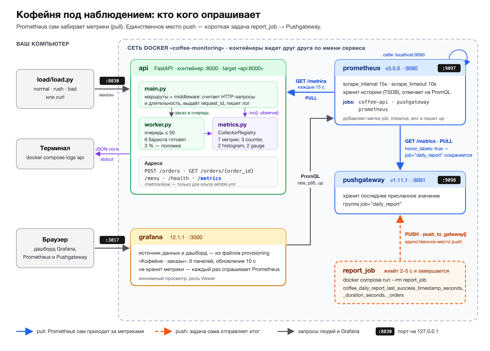

# Кофейня под наблюдением: Prometheus + Grafana

Учебно-прикладной проект: небольшой сервис приёма заказов кофейни на FastAPI и стенд
мониторинга к нему. На работающем сервисе здесь видно всё, что входит в базовый
мониторинг на Prometheus: страница `/metrics`, три типа метрик, метки и их ограничения,
target, job и instance, scrape и его ошибки, pull-модель, Pushgateway для короткой
задачи, запросы PromQL и дашборд Grafana.

Проект продолжает материал модулей 1–2 курса «Метрики и наблюдаемость»: там стенд
состоял из одного счётчика и одного Prometheus, здесь — полноценный маленький сервис.

---

## 1. Что за проект и какие допущения

Кофейня принимает заказы через API. Путь заказа:

1. Клиент отправляет `POST /orders` с напитком и размером. API проверяет данные
   и ставит заказ в очередь. Ответ — `202 Accepted` и номер заказа.
2. Фоновый обработчик (бариста) берёт заказ из очереди и готовит его.
3. Клиент проверяет статус: `GET /orders/{order_id}` → `queued`, `preparing`, `ready` или `failed`.

Раз в сутки ночью запускается короткая задача `daily_report`: считает выручку и завершается.

| Метод и путь | Что делает | Ответы |
|---|---|---|
| `POST /orders` | принимает `{"drink": "latte", "size": "M"}`, ставит в очередь | 202; 422 — неверные данные; 503 — в очереди уже 50 заказов |
| `GET /orders/{order_id}` | статус заказа | 200; 404 — заказа нет |
| `GET /menu` | espresso, americano, latte, cappuccino, raf | 200 |
| `GET /health` | процесс жив | 200 |
| `GET /metrics` | метрики в текстовом формате Prometheus | 200 |
| `GET /metrics/slow` | те же метрики через 2 с — **только** для опыта с ошибками | 200 |

**Допущения (сделаны сознательно, это учебный стенд):**

- **Хранение в памяти процесса.** Базы данных нет: заказы лежат в словаре, очередь —
  `asyncio.Queue`. После перезапуска контейнера `api` все заказы и все счётчики
  обнуляются. Для мониторинга это даже полезно: видно, как Prometheus переживает сброс счётчика.
- **Бариста — asyncio-задачи внутри того же процесса.** Их 6 (переменная `BARISTAS`).
- **Время приготовления случайное:** espresso 1 с, americano 1,5 с, latte и cappuccino 2,5 с,
  raf 4 с, разброс ±30 %. `SLOW_MODE=1` умножает время на 3.
- **~3 % заказов завершаются ошибкой** «сломалась кофемашина» (`failed`) — случайно.
- **Число заказов в ночном отчёте случайное** (150–400): у задачи нет доступа к памяти API.
  Важен механизм отправки метрик, а не цифра.

### Структура

```
coffee-monitoring/
├── README.md                   этот файл
├── OTCHET.md                   отчёт о проверке критериев приёмки
├── POSHAGOVO.md                как собрать проект самому за 14 этапов
├── docs/schema.svg, schema.png схема стенда
├── compose.yaml                4 постоянных сервиса + report_job (профиль jobs)
├── app/
│   ├── Dockerfile
│   ├── requirements.txt        fastapi 0.115.6, uvicorn 0.34.0, prometheus-client 0.26.0
│   ├── main.py                 маршруты и middleware (метрики HTTP + лог)
│   ├── metrics.py              объявление всех метрик в одном месте
│   ├── worker.py               бариста: фоновый обработчик очереди
│   └── logging_setup.py        логи в JSON
├── report_job/
│   ├── Dockerfile
│   └── daily_report.py         короткая задача → push в Pushgateway
├── prometheus/
│   ├── prometheus.yml          рабочие настройки
│   └── oshibki.yml             настройки с намеренными ошибками
├── grafana/provisioning/
│   ├── datasources/prometheus.yaml
│   └── dashboards/             dashboards.yaml (подключение) + coffee.json (дашборд)
└── load/
    └── load.py                 генератор нагрузки: normal, rush, bad
```

---

## 2. Схема: кто кого опрашивает



Та же схема в векторе: [docs/schema.svg](docs/schema.svg). Ниже — текстовый вариант.

```
                          pull каждые 15 с: GET /metrics
     ┌──────────────┐  ◄──────────────────────────────────┐
     │  api :8000   │                                      │
     │  (FastAPI)   │                                ┌─────┴────────┐   PromQL   ┌─────────────┐
     └──────▲───────┘                                │  Prometheus  │ ◄───────── │   Grafana   │
            │ POST /orders,                          │    :9090     │  (Grafana  │    :3000    │
            │ GET /orders/{id}                       └─────┬────┬───┘  спрашивает└─────────────┘
     ┌──────┴───────┐                                      │    │       Prometheus)
     │   load.py    │               pull: GET /metrics     │    │ pull: себя же
     │  (нагрузка)  │        ┌─────────────────────────────┘    └──────► localhost:9090
     └──────────────┘        ▼
                      ┌──────────────┐
                      │ pushgateway  │
                      │    :9091     │
                      └──────▲───────┘
                             │  PUSH (единственное место push во всём стенде)
                      ┌──────┴───────┐
                      │  report_job  │  живёт несколько секунд и завершается
                      └──────────────┘
```

**Направление запросов.** Почти везде работает **pull**: запрос идёт *от* Prometheus
*к* цели. API ничего никуда не отправляет — он только отвечает на `GET /metrics`.
Grafana тоже не хранит данные, а при каждом обновлении панели спрашивает Prometheus.

**Единственное место push** — `report_job → pushgateway`. Но даже здесь Prometheus
забирает данные из Pushgateway обычным pull.

---

## 3. Запуск, остановка, адреса

Нужен только Docker (с Compose v2) и Python 3 для генератора нагрузки
(сторонние библиотеки не нужны).

```bash
cd coffee-monitoring
docker compose up -d --build      # запуск (первый раз — сборка образов)
docker compose ps                 # 4 контейнера в состоянии Up
docker compose logs -f api        # логи API в JSON

docker compose down               # остановка, данные Prometheus и Grafana сохранятся в томах
docker compose down -v            # остановка и удаление томов (начать с чистого листа)
```

| Сервис | Адрес на компьютере | Порт в контейнере |
|---|---|---|
| API | http://127.0.0.1:8030 (метрики: `/metrics`, документация: `/docs`) | 8000 |
| Prometheus | http://127.0.0.1:9097 (цели: `/targets`) | 9090 |
| Pushgateway | http://127.0.0.1:9098 | 9091 |
| Grafana | http://127.0.0.1:3017 (без входа, роль Viewer; админ: admin / admin) | 3000 |

Все порты открыты только на `127.0.0.1`: с других компьютеров сети стенд не виден.
Порты выбраны нестандартные, чтобы не мешать вашим 8000, 9090 и 3000.

> На Windows вместо `python3` пишите `python`, а переменные окружения задавайте так:
> `$env:PROM_CONFIG="oshibki.yml"; docker compose up -d` (PowerShell).

---

## 4. Проход по проекту

Шаги идут по порядку, каждый опирается на предыдущий. У каждого — команда и что
должно получиться.

### Шаг 1. Запуск

```bash
docker compose up -d --build
docker compose ps
```

**Должно получиться:** четыре строки — `api`, `pushgateway`, `prometheus`, `grafana`,
у всех `STATUS` = `Up …`. Сервис `report_job` не запускается: у него профиль `jobs`,
он стартует только вручную (шаг 10).

### Шаг 2. `/metrics` до первых заказов

```bash
curl -i http://127.0.0.1:8030/metrics
```

**Должно получиться:**

```
HTTP/1.1 200 OK
content-type: text/plain; version=1.0.0; charset=utf-8
x-request-id: 1c3ae61d6cc94760ad1d6dc09cfbd355

# HELP coffee_http_requests_total HTTP-запросы к API кофейни (без /metrics и /health)
# TYPE coffee_http_requests_total counter
# HELP coffee_http_request_duration_seconds Длительность обработки HTTP-запроса
# TYPE coffee_http_request_duration_seconds histogram
# HELP coffee_orders_total Завершённые заказы по напитку и результату
# TYPE coffee_orders_total counter
# HELP coffee_order_prepare_seconds Время приготовления готового заказа
# TYPE coffee_order_prepare_seconds histogram
# HELP coffee_queue_length Заказов в очереди сейчас (ещё не взяты бариста)
# TYPE coffee_queue_length gauge
coffee_queue_length 0.0
# HELP coffee_baristas_busy Сколько бариста (фоновых обработчиков) сейчас готовят
# TYPE coffee_baristas_busy gauge
coffee_baristas_busy 0.0
# HELP coffee_orders_rejected_total Отклонённые заказы по причине
# TYPE coffee_orders_rejected_total counter
```

Что здесь важно:

- **У счётчиков и гистограмм с метками рядов нет вообще** — только строки `HELP` и `TYPE`.
  Ряд `coffee_orders_total{drink="latte",result="ready"}` появится только после первого
  `.labels(...).inc()`. Библиотека не знает заранее, какие значения меток будут.
- **У gauge без меток значение есть сразу — 0.** У такой метрики ровно один ряд, и он
  создаётся при объявлении.
- «Ряда нет» и «ряд равен 0» — разные состояния. В PromQL первое даёт пустой результат.
- Метрик интерпретатора (`python_gc_*`, `process_*`) нет: используется собственный
  `CollectorRegistry`, а не глобальный реестр библиотеки.
- Рядов `*_created` нет: вызван `disable_created_metrics()`.
- Заголовок `Content-Type` — `text/plain; version=…`: по нему Prometheus понимает формат.

### Шаг 3. Первые заказы

```bash
curl -i -X POST http://127.0.0.1:8030/orders \
     -H 'Content-Type: application/json' -d '{"drink": "latte", "size": "M"}'
curl http://127.0.0.1:8030/orders/1          # сразу: preparing
sleep 4; curl http://127.0.0.1:8030/orders/1 # через несколько секунд: ready
curl -X POST http://127.0.0.1:8030/orders \
     -H 'Content-Type: application/json' -d '{"drink": "mojito", "size": "M"}'   # 422
curl -s http://127.0.0.1:8030/metrics | grep -v '^#' | grep -v _bucket
docker compose logs api --tail 5
```

**Должно получиться:** ответ `202` и `{"order_id":1,"status":"queued"}`, затем `preparing`
и `ready`. На `/metrics` появились ряды:

```
coffee_http_requests_total{method="POST",route="/orders",status="202"} 1.0
coffee_http_requests_total{method="POST",route="/orders",status="422"} 1.0
coffee_http_requests_total{method="GET",route="/orders/{order_id}",status="200"} 2.0
coffee_orders_total{drink="latte",result="ready"} 1.0
coffee_order_prepare_seconds_count{drink="latte"} 1.0
coffee_orders_rejected_total{reason="invalid"} 1.0
```

Обратите внимание: `route="/orders/{order_id}"` — **шаблон**, а не `/orders/1`. Сколько бы
заказов ни проверили, ряд один. А в логе каждый запрос — отдельная JSON-строка
со своим `request_id` (он же в заголовке ответа `X-Request-ID`):

```json
{"timestamp": "2026-10-13T13:52:10.120Z", "level": "INFO", "service": "coffee-api", "event": "http_request", "method": "POST", "route": "/orders", "status": 202, "duration_ms": 3.1, "request_id": "9b0e…"}
```

Запросы к `/metrics` и `/health` в лог попадают, а в `coffee_http_requests_total` — нет:
их делают Prometheus и проверки живости, а не клиенты.

### Шаг 4. Target health: все цели UP

Откройте http://127.0.0.1:9097/targets (в Prometheus 3 страница называется **Target health**).

**Должно получиться:** три задания (job) — `coffee-api`, `pushgateway`, `prometheus`,
у каждого по одной цели (target) в состоянии **UP**, колонка *Last scrape* — несколько
секунд назад, *Error* пустая. У `coffee-api` в метках видно `env="dev"`,
`instance="api:8000"`, `job="coffee-api"`.

- **target** — адрес, куда Prometheus ходит за метриками (`api:8000`);
- **job** — имя задания `job_name` из `prometheus.yml`, группа однотипных целей;
- **instance** — метка с адресом конкретной цели внутри задания.

Prometheus добавляет `job` и `instance` к каждому ряду, который забрал с цели.

### Шаг 5. Запросы `up` и `coffee_orders_total` в Prometheus

Сначала дайте нагрузку (3 минуты):

```bash
python3 load/load.py normal
```

Пока она идёт, откройте http://127.0.0.1:9097/query и выполните:

| Запрос | Что должно получиться |
|---|---|
| `up` | три ряда со значением `1`: `job="coffee-api"`, `job="pushgateway"`, `job="prometheus"` |
| `coffee_orders_total` | ряды вида `coffee_orders_total{drink="raf", env="dev", instance="api:8000", job="coffee-api", result="ready"}` |
| `sum by (result) (rate(coffee_orders_total[1m])) * 60` | около 115 `ready` и 3–4 `failed` в минуту |
| `scrape_duration_seconds{job="coffee-api"}` | сколько длился последний scrape, тысячные доли секунды |

Метки `drink` и `result` поставило приложение. Метки `job`, `instance` и `env`
добавил Prometheus при scrape — в ответе `/metrics` их нет.

В конце `load.py` печатает итог, например:

```
Итог: запросов отправлено 540
  GET /orders/{id}                            200  × 180
  POST /orders                                202  × 360
```

### Шаг 6. Сценарий `rush` и рост очереди на дашборде

Откройте Grafana http://127.0.0.1:3017 — дашборд «Кофейня · заказы» открывается сразу,
без входа. Затем:

```bash
python3 load/load.py rush
```

**Должно получиться:** 10 заказов в секунду, а 6 бариста успевают ~2,6. Очередь на панели
«Очередь и занятые бариста» за несколько секунд дорастает до 50, занятые бариста — до 6.
Дальше API отвечает `503`:

```
Итог: запросов отправлено 900
  POST /orders                                202  × 200
  POST /orders                                503  × 400
  ...
```

В Prometheus: `coffee_orders_rejected_total{reason="queue_full"}` растёт,
`sum by (status) (rate(coffee_http_requests_total{route="/orders"}[1m]))` показывает долю 503.
Через ~20 секунд после конца сценария очередь рассасывается до 0.

> Обратите внимание: на графике очередь видна «ступеньками» раз в 15 с. Prometheus видит
> только значения в моменты scrape; что было между ними, для gauge неизвестно.

### Шаг 7. Остановка API и `up = 0`

```bash
docker compose stop api
```

Подождите 15–30 секунд (один-два `scrape_interval`) и выполните в Prometheus `up{job="coffee-api"}`.

**Должно получиться:** значение `0`. На странице Target health цель `api:8000` — **DOWN**.
Текст ошибки зависит от того, как Docker отвечает на запрос имени остановленного контейнера:
на Docker Desktop (macOS) это `Get "http://api:8000/metrics": context deadline exceeded` —
поиск имени `api` не уложился в `scrape_timeout`; на Linux чаще
`dial tcp: lookup api … no such host` — имени в сети Docker больше нет. На дашборде
панель «Доступность целей» для `coffee-api` стала красной.

Обратите внимание: одинаковый текст `context deadline exceeded` бывает и у медленного
`/metrics` (шаг 11), и у недоступного имени. Текст ошибки — подсказка, а не диагноз:
проверяйте и `docker compose ps`.

`up` пишет сам Prometheus, а не приложение: если приложение не ответило, некому
было бы сообщить «я упало». Поэтому `up == 0` — главный сигнал «цель недоступна».

### Шаг 8. Запуск и обнуление счётчиков

```bash
docker compose start api
curl -s http://127.0.0.1:8030/metrics | grep coffee_orders_total
```

**Должно получиться:** `up{job="coffee-api"}` снова `1`. На `/metrics` у счётчиков снова
нет рядов — процесс новый, всё хранилось в памяти. В Prometheus на графике
`coffee_orders_total` видно падение до нуля (запрос `coffee_orders_total`, вкладка Graph).

Запустите `python3 load/load.py normal --duration 60` и посмотрите на
`rate(coffee_orders_total[1m])`: провала в минус нет. `rate()` и `increase()` понимают
сброс счётчика — если значение стало меньше предыдущего, они считают, что счётчик начал
с нуля. Поэтому на сырое значение счётчика смотреть бесполезно, смотрят на `rate()`.

### Шаг 9. `SLOW_MODE=1` и рост p95 приготовления

```bash
SLOW_MODE=1 docker compose up -d api       # пересоздаёт только api
docker compose logs api | grep slow_factor # slow_factor=3.0
python3 load/load.py normal --duration 120
```

**Должно получиться:** на панели «p95 приготовления по напитку» линии поднимаются
примерно втрое. Запрос в Prometheus:

```
histogram_quantile(0.95, sum by (le, drink) (rate(coffee_order_prepare_seconds_bucket[2m])))
```

Пример после 2 минут нагрузки в SLOW_MODE:

```
{drink="espresso"}    3.91
{drink="americano"}   5.65
{drink="latte"}       9.8
{drink="cappuccino"}  9.77
{drink="raf"}        15
```

Ровно `15` у raf — не измерение, а **верхняя граница последней корзины**. Часть raf
готовилась дольше 15 с и попала в корзину `+Inf`, а у неё нет верхней границы. В таком случае
`histogram_quantile` возвращает границу последней конечной корзины. Вывод: «p95 ≥ 15 с»,
точнее сказать нельзя. Если такие значения нормальны для сервиса — корзины нужно расширять.

Побочный эффект: бариста теперь успевают ~0,9 заказа в секунду при 2 входящих — очередь
снова переполняется и появляются 503. Медленная обработка превращается в отказы клиентам —
и это видно на соседних панелях. p95 HTTP при этом почти не меняется: API отвечает сразу,
медленная часть — в фоне. Это хороший пример, почему мерить нужно не только HTTP.

Вернуть обычную скорость:

```bash
docker compose up -d api
```

### Шаг 10. Отчётная задача и её метрики в Pushgateway

```bash
docker compose run --rm report_job
```

**Должно получиться:**

```
daily_report: считаю выручку за день...
daily_report: заказов за день 287
daily_report: метрики отправлены в pushgateway:9091
```

Контейнер завершился и удалён. Откройте Pushgateway http://127.0.0.1:9098 — там группа
`job="daily_report"` с тремя метриками. В Prometheus (после ближайшего scrape, до 15 с):

```
coffee_daily_report_last_success_timestamp_seconds
# → coffee_daily_report_last_success_timestamp_seconds{job="daily_report"}  1791900165.71
time() - coffee_daily_report_last_success_timestamp_seconds
# → сколько секунд назад отчёт прошёл успешно (для правила «отчёт не проходил > 26 ч»)
```

Метка `job="daily_report"` — та, с которой задача отправила метрики. Её сохранил
`honor_labels: true` в задании `pushgateway`. В самом Pushgateway (`curl -s
http://127.0.0.1:9098/metrics | grep coffee_daily`) у ряда есть `instance=""` — задача
его не задавала. В Prometheus метка с пустым значением равна отсутствию метки, поэтому
`instance` в результате нет вовсе.

**Почему эту задачу нельзя собирать через pull.** Задача живёт 2–5 секунд, а Prometheus
приходит раз в 15 секунд. Скорее всего, к его приходу процесса уже нет, и `/metrics`
отдать некому. Даже если повезёт, Prometheus увидит промежуточное значение, а не итог.
Поэтому задача сама отправляет итог в Pushgateway, который живёт постоянно и хранит
последнее значение.

**Почему постоянно работающий API через Pushgateway не отправляют:**

- пропадает `up`: Pushgateway отдаёт последнее присланное значение, даже если API давно упал.
  Мы не узнаем о падении по метрикам;
- Pushgateway становится единой точкой отказа и узким местом для всех сервисов;
- значения в Pushgateway не стираются сами — метрики удалённого сервиса висят вечно;
- теряется смысл `instance`: цель одна (Pushgateway), а не каждый экземпляр API.

Pull для долгоживущего сервиса даёт всё это бесплатно: Prometheus сам знает список целей
и сам замечает, что цель не отвечает.

### Шаг 11. Опыт с `oshibki.yml` и разбор каждого текста ошибки

```bash
PROM_CONFIG=oshibki.yml docker compose up -d   # пересоздаёт prometheus с другим файлом
```

Подождите 15–30 секунд и откройте http://127.0.0.1:9097/targets.

**Должно получиться:** три рабочих задания UP и четыре — **DOWN**:

| Задание | Ошибка в настройке | Текст на Target health | Почему |
|---|---|---|---|
| `wrong-path` | `metrics_path: /stats` | `server returned HTTP status 404 Not Found` | соединение есть, API ответил, но по пути `/stats` ничего нет |
| `localhost` | target `localhost:8000` | `Get "http://localhost:8000/metrics": dial tcp [::1]:8000: connect: connection refused` | внутри контейнера Prometheus `localhost` — сам Prometheus, а не API |
| `slow` | `scrape_timeout: 1s`, путь `/metrics/slow` (отвечает через 2 с) | `Get "http://api:8000/metrics/slow": context deadline exceeded` | Prometheus ждал 1 с и прервал запрос |
| `wrong-port` | target `api:8001` | `Get "http://api:8001/metrics": dial tcp 192.168.32.2:8001: connect: connection refused` | имя `api` нашлось (в тексте — IP контейнера, у вас он может быть другим), но на порту 8001 никто не слушает |

Как читать текст ошибки — по слоям, снизу вверх:

1. `no such host` — не нашли имя (DNS). Опечатка в имени или контейнер не запущен.
2. `connection refused` — имя нашли, машина ответила «на этом порту никого». Не тот порт
   или не тот хост (`localhost`).
3. `context deadline exceeded` — соединились, но ответ не уложился в `scrape_timeout`.
4. `HTTP status 404` — ответ получен, но путь неверный.

Сравните `up` для всех заданий: `up{job="slow"}` — 0, хотя API жив. `up = 0` значит
«не удалось собрать», а не «сервис упал».

### Шаг 12. Возврат рабочих настроек и `promtool check config`

```bash
docker compose up -d                       # без PROM_CONFIG — снова prometheus.yml
docker compose exec prometheus promtool check config /etc/prometheus/prometheus.yml
```

**Должно получиться:**

```
Checking /etc/prometheus/prometheus.yml
 SUCCESS: /etc/prometheus/prometheus.yml is valid prometheus config file syntax
```

На Target health снова три задания. Четыре ошибочных исчезли со страницы, но их ряды
`up{job="wrong-path"}` и другие остались в базе за прошлое время.

`promtool` проверяет синтаксис и допустимые значения (например, timeout не больше interval).
Он **не** проверяет, что цель доступна: `oshibki.yml` тоже пройдёт проверку.
Изменили настройки без пересоздания контейнера — перечитать можно так:
`curl -X POST http://127.0.0.1:9097/-/reload` (работает благодаря `--web.enable-lifecycle`).

---

## 5. Метрика — тип — почему такой тип

| Метрика | Тип | Почему такой тип |
|---|---|---|
| `coffee_http_requests_total{method,route,status}` | counter | число запросов только растёт; скорость получаем через `rate()`, сброс при перезапуске `rate()` переживает |
| `coffee_http_request_duration_seconds{route}` | histogram | нужна не средняя, а распределение — сколько запросов быстрее 5 мс, 10 мс, … — чтобы считать p95 и складывать по нескольким экземплярам |
| `coffee_orders_total{drink,result}` | counter | завершённые заказы только прибавляются; заказы в минуту и долю ошибок считаем из `rate()` |
| `coffee_order_prepare_seconds{drink}` | histogram | время приготовления имеет разброс; средняя спрятала бы долгие raf, p95 — нет |
| `coffee_queue_length` | gauge | состояние «сейчас»: растёт и падает; `rate()` к нему не применяют |
| `coffee_baristas_busy` | gauge | состояние «сейчас»: от 0 до 6 |
| `coffee_orders_rejected_total{reason}` | counter | событий-отказов только больше; важна скорость появления |
| `coffee_daily_report_last_success_timestamp_seconds` | gauge | момент времени, перезаписывается при каждом успехе |
| `coffee_daily_report_duration_seconds` | gauge | длительность последнего запуска, одно значение (гистограмма из одного наблюдения в сутки смысла не имеет) |
| `coffee_daily_report_orders` | gauge | итог последнего отчёта; каждый раз новое значение, а не прибавка |

Почему **summary** не используется: квантили summary считаются внутри процесса, и p95
двух экземпляров нельзя сложить. Гистограмма отдаёт корзины, их Prometheus суммирует
по экземплярам, а квантиль считается уже в PromQL.

**Границы корзин** (подробно — в комментариях `app/metrics.py`):

- HTTP: `0.005 0.01 0.025 0.05 0.1 0.25 0.5 1` с — API отвечает из памяти за миллисекунды,
  всё дольше секунды — авария;
- приготовление: `0.5 1 1.5 2 3 4 5 6 8 10 12 15` с — от самого быстрого espresso (0,7 с)
  до самого долгого raf в SLOW_MODE (~15 с), гуще там, где большинство заказов.

**Почему в метках нет номера заказа.** Каждое новое значение метки — новый временной ряд.
Номеров заказов — неограниченно много, за день появились бы тысячи рядов, каждый с одним
значением. Это кардинальность: память Prometheus и время запросов растут вместе с ней.
Номер заказа есть в логе (`order_failed` с `order_id`) — там ему и место. Проверка:

```bash
curl -s http://127.0.0.1:8030/metrics | grep -E 'order_id|/orders/[0-9]' || echo "нет — хорошо"
```

---

## 6. Если target не UP: что видно — причина — что сделать

| Что видно на Target health | Причина | Что сделать |
|---|---|---|
| `server returned HTTP status 404 Not Found` | неверный `metrics_path` | открыть адрес в браузере / `curl`, исправить путь (`/metrics`) |
| `connect: connection refused` на `localhost:…` | `localhost` внутри контейнера Prometheus — сам Prometheus | указать имя сервиса из compose (`api:8000`) |
| `connect: connection refused` на `имя:порт` | приложение не слушает этот порт (не тот порт или приложение не запустилось) | `docker compose ps`, `docker compose logs api`, сверить порт **в контейнере** (8000, а не 8030) |
| `dial tcp: lookup api … no such host` или `context deadline exceeded` у цели, которая раньше работала | контейнер остановлен или опечатка в имени | `docker compose ps`, `docker compose start api`, проверить имя |
| `context deadline exceeded` | ответ дольше `scrape_timeout` | выяснить, почему `/metrics` медленный (слишком много рядов? тяжёлые вычисления при сборе?); timeout увеличивать в последнюю очередь |
| `EOF` / `connection reset by peer` | процесс упал или перезапускается во время scrape | `docker compose logs api`, причина перезапусков |
| `received unsupported Content-Type` | ответ не в формате Prometheus (например, JSON или HTML) | отдавать `generate_latest(...)` с `media_type=CONTENT_TYPE_LATEST` |
| `... while parsing ...` | ошибка в тексте ответа | `curl /metrics` и найти неверную строку |
| Цели нет на странице вовсе | задание не в настройках или Prometheus читает другой файл | `promtool check config`, `POST /-/reload`, проверить `PROM_CONFIG` |

---

## 7. Что не так в рабочей системе

Стенд нарочно упрощён. В рабочей системе это было бы иначе:

- **Хранение в памяти.** Заказы теряются при перезапуске; несколько экземпляров API
  не видят заказы друг друга. Нужна база данных и очередь (Redis, RabbitMQ, Kafka).
- **Бариста внутри процесса API.** Обработчики должны быть отдельным сервисом со своими
  метриками и своим target, чтобы масштабировать их отдельно.
- **Один процесс uvicorn.** При нескольких процессах `prometheus-client` нужен
  multiprocess-режим, иначе каждый процесс отдаёт свои числа.
- **Анонимный вход в Grafana с ролью Viewer и пароль `admin/admin`.** Так нельзя:
  нужна авторизация (SSO/LDAP), отдельные пароли, HTTPS.
- **Prometheus, Pushgateway и `/metrics` без авторизации и без TLS**, `--web.enable-lifecycle`
  открыт любому, кто достучится до порта. В рабочей системе — закрытая сеть, reverse proxy,
  basic auth/TLS.
- **Нет алертов.** Метрики есть, но никто не получит сообщение, когда `up == 0` или доля
  `failed` превысила 5 %. Нужны правила (`rule_files`) и Alertmanager.
- **Статический список целей.** В Kubernetes или облаке цели находят автоматически
  (service discovery), а не прописывают руками.
- **Хранение данных Prometheus** — по умолчанию 15 дней на одном диске, без реплик.
  Для долгого хранения и отказоустойчивости — Thanos, Mimir, VictoriaMetrics.
- **Pushgateway без очистки.** Группы, которые больше никто не обновляет, висят вечно;
  нужна политика удаления (`DELETE /metrics/job/...`) и алерт на «устаревший» timestamp.
- **Логи только в stdout.** В рабочей системе их собирают в хранилище (Loki, Elasticsearch)
  и связывают с метриками и трассами по `request_id` / trace id. Трасс здесь нет совсем.
- **Нагрузка от одного клиента с одного компьютера** не похожа на реальный трафик.

---

## Полезные запросы PromQL

```
up                                                         # доступность всех целей
sum by (result) (rate(coffee_orders_total[1m])) * 60       # заказов в минуту
sum(rate(coffee_orders_total{result="failed"}[5m]))
  / sum(rate(coffee_orders_total[5m]))                     # доля неудачных
coffee_queue_length                                        # очередь сейчас
rate(coffee_orders_rejected_total[1m])                     # отказы в секунду по причине
histogram_quantile(0.95, sum by (le, drink)
  (rate(coffee_order_prepare_seconds_bucket[5m])))         # p95 приготовления
histogram_quantile(0.95, sum by (le, route)
  (rate(coffee_http_request_duration_seconds_bucket[5m]))) # p95 HTTP
time() - coffee_daily_report_last_success_timestamp_seconds  # возраст ночного отчёта, с
scrape_duration_seconds                                    # длительность scrape по целям
```
